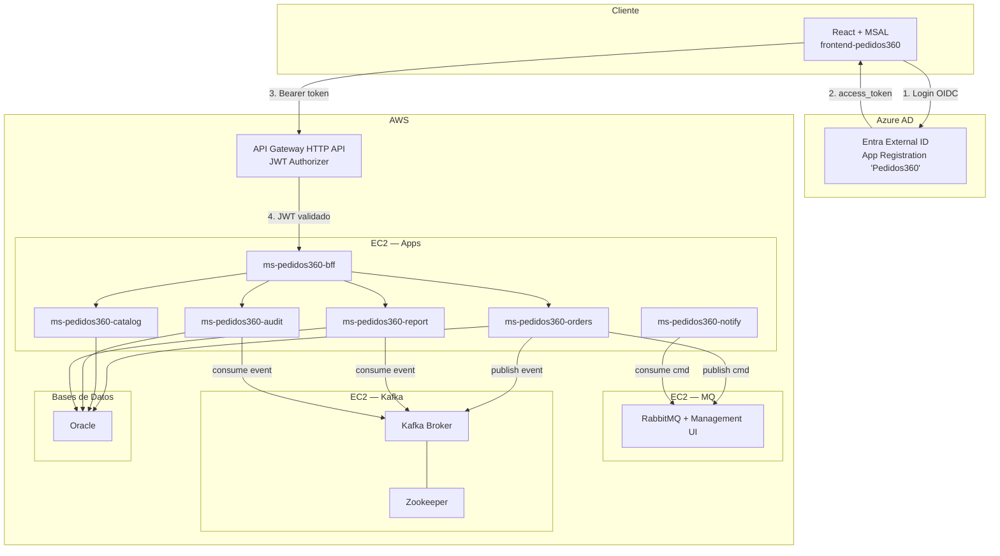
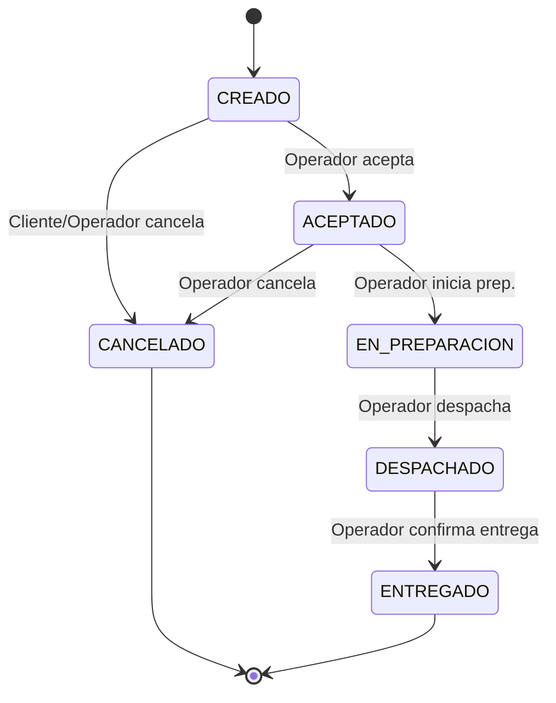

# Pedidos360 — Plan de Implementación

> **Stack frontend:** React 19 + TypeScript + Vite (reemplaza Angular del enunciado)
> **Stack backend:** Spring Boot 3+ / Java 21
> **Infraestructura:** AWS EC2 + Docker-Compose · RabbitMQ · Kafka + Zookeeper
> **Identidad:** Azure AD (Entra External ID) + MSAL React + AWS API Gateway JWT Authorizer

---

## 1. Arquitectura General



---

## 2. Repositorios y Estructura de Carpetas

```
cloudnative/
├── frontend/                          # React 19 + TypeScript + Vite + MSAL
│   └── src/
│       ├── auth/                      # MSAL config, AuthProvider, guards
│       ├── components/                # Componentes compartidos (Layout, Sidebar, etc.)
│       ├── pages/                     # Páginas por ruta
│       │   ├── Login/
│       │   ├── Dashboard/
│       │   ├── Orders/
│       │   ├── Catalog/
│       │   ├── Reports/
│       │   └── Audit/
│       ├── hooks/                     # Custom hooks (useAuth, useApi, useRoles)
│       ├── services/                  # API clients (axios/fetch wrappers)
│       ├── types/                     # Tipos TypeScript compartidos
│       └── router/                    # React Router config + role guards
│
├── ms-pedidos360-bff/                 # Spring Boot — Backend For Frontend
├── ms-pedidos360-orders/              # Spring Boot — Pedidos
├── ms-pedidos360-catalog/             # Spring Boot — Catálogo/Stock
├── ms-pedidos360-notify/              # Spring Boot — Notificaciones (consumer RabbitMQ)
├── ms-pedidos360-report/              # Spring Boot — KPIs (consumer Kafka)
├── ms-pedidos360-audit/               # Spring Boot — Auditoría (consumer Kafka)
│
├── infra/
│   ├── apps/compose.yml               # Todos los microservicios
│   ├── mq/compose.yml                 # RabbitMQ
│   └── kafka/compose.yml              # Zookeeper + Kafka
│
└── docs/                              # Documentación técnica
```

---

## 3. Fases de Implementación

### Fase 0 — Scaffold y Configuración Base

| # | Tarea | Detalle |
|---|-------|---------|
| 0.1 | **Configurar frontend React** | El proyecto ya existe con React 19 + Vite + TypeScript. Agregar dependencias: `@azure/msal-browser`, `@azure/msal-react`, `react-router-dom`, `axios`, `recharts` (gráficos). |
| 0.2 | **Scaffold microservicios** | Crear cada servicio Spring Boot 3+ con Java 21 usando Spring Initializr: `spring-boot-starter-web`, `spring-boot-starter-security`, `spring-boot-starter-oauth2-resource-server`, `springdoc-openapi`. |
| 0.3 | **Azure AD App Registration** | Registrar app "Pedidos360" en Entra ID. Configurar `clientId`, `redirectUri`, `authority`. Definir App Roles: `Admin`, `Operador`, `Cliente`, `Auditor`. |
| 0.4 | **Docker Compose base** | Crear los 3 compose files (apps, mq, kafka) con imágenes base y redes. |

---

### Fase 1 — Autenticación y Autorización

#### 1.1 Frontend — MSAL React

```
Dependencias:
  @azure/msal-browser
  @azure/msal-react
```

| Archivo | Responsabilidad |
|---------|-----------------|
| `src/auth/msalConfig.ts` | Configuración MSAL: `clientId`, `authority`, `redirectUri`, scopes |
| `src/auth/AuthProvider.tsx` | Wrapper `<MsalProvider>` alrededor de la app |
| `src/auth/useAuth.ts` | Hook: `login()`, `logout()`, `getToken()`, `user`, `roles` |
| `src/auth/RoleGuard.tsx` | Componente que protege rutas según roles del token |
| `src/auth/AuthCallback.tsx` | Página `/auth/callback` — manejo de redirect post-login |

**Flujo:**
1. Usuario accede a `/login` → botón "Iniciar sesión con Microsoft"
2. MSAL redirige a Azure AD → usuario se autentica
3. Azure AD redirige a `/auth/callback` con tokens
4. `useAuth` expone `accessToken` y `roles` del JWT
5. Todas las requests HTTP incluyen header `Authorization: Bearer <token>`

#### 1.2 Backend — Spring Security + OAuth2 Resource Server

Cada microservicio valida el JWT:

```yaml
# application.yml (por servicio)
spring:
  security:
    oauth2:
      resourceserver:
        jwt:
          issuer-uri: https://login.microsoftonline.com/<TENANT_ID>/v2.0
          audiences: api://<API_CLIENT_ID>
```

- `SecurityConfig.java`: configura `http.oauth2ResourceServer().jwt()` + filtros por rol.
- Anotaciones `@PreAuthorize("hasRole('Admin')")` en controllers.

#### 1.3 AWS API Gateway

- Crear HTTP API con **JWT Authorizer**:
  - `issuer`: `https://login.microsoftonline.com/<TENANT_ID>/v2.0`
  - `audiences`: `api://<API_CLIENT_ID>`
- Routes → Integration con ALB / IPs de EC2 de cada servicio.

---

### Fase 2 — Módulo Catálogo (`ms-pedidos360-catalog`)

> **Prioridad alta** — el catálogo es pre-requisito para crear pedidos.

#### 2.1 Backend

| Capa | Clase | Detalle |
|------|-------|---------|
| Entity | `Product` | `id`, `name`, `description`, `price`, `stock`, `imageUrl`, `active` |
| Repository | `ProductRepository` | JPA / Oracle |
| Service | `CatalogService` | CRUD + validaciones de stock |
| Controller | `CatalogController` | `GET/POST/PUT/DELETE /api/catalog/**` |
| OpenAPI | `springdoc` | Swagger auto-generado |

**Endpoints:**

| Método | Ruta | Roles | Descripción |
|--------|------|-------|-------------|
| `GET` | `/api/catalog/products` | Admin, Operador | Listar productos |
| `GET` | `/api/catalog/products/{id}` | Admin, Operador | Detalle producto |
| `POST` | `/api/catalog/products` | Admin | Crear producto |
| `PUT` | `/api/catalog/products/{id}` | Admin | Editar producto |
| `DELETE` | `/api/catalog/products/{id}` | Admin | Eliminar producto |
| `PATCH` | `/api/catalog/products/{id}/stock` | Admin, Operador | Actualizar stock |

#### 2.2 Frontend — Página `/catalog`

| Componente | Descripción |
|------------|-------------|
| `CatalogPage` | Página principal, layout grid/lista |
| `ProductCard` | Tarjeta de producto con imagen, precio, stock |
| `ProductForm` | Modal/drawer para crear/editar producto |
| `ProductTable` | Vista tabla alternativa |

---

### Fase 3 — Módulo Pedidos (`ms-pedidos360-orders`)

#### 3.1 Máquina de Estados



**Regla clave:** No se puede despachar sin aceptar primero. Transiciones inválidas lanzan `400 Bad Request`.

#### 3.2 Backend

| Capa | Clase | Detalle |
|------|-------|---------|
| Entity | `Order` | `id`, `customerId`, `status`, `items[]`, `totalAmount`, `createdAt`, `updatedAt` |
| Entity | `OrderItem` | `productId`, `quantity`, `unitPrice` |
| Enum | `OrderStatus` | `CREADO`, `ACEPTADO`, `EN_PREPARACION`, `DESPACHADO`, `ENTREGADO`, `CANCELADO` |
| Service | `OrderService` | CRUD + máquina de estados + publicación eventos |
| Controller | `OrderController` | `GET/POST/PATCH /api/orders/**` |

**Endpoints:**

| Método | Ruta | Roles | Descripción |
|--------|------|-------|-------------|
| `GET` | `/api/orders` | Admin, Operador, Cliente | Listar pedidos (filtrado por rol) |
| `GET` | `/api/orders/{id}` | Admin, Operador, Cliente | Detalle pedido |
| `POST` | `/api/orders` | Cliente, Operador | Crear pedido |
| `PATCH` | `/api/orders/{id}/status` | Operador, Admin | Cambiar estado |

**Al cambiar estado:**
1. Validar transición permitida (máquina de estados)
2. Si `ACEPTADO` → decrementar stock en `ms-pedidos360-catalog` (llamada síncrona o evento)
3. Publicar evento a **Kafka** topic `orders.events` (e.g., `OrderAccepted`)
4. Publicar comando a **RabbitMQ** para notificación (e.g., `email.send`)

#### 3.3 Frontend — Página `/orders`

| Componente | Descripción |
|------------|-------------|
| `OrdersPage` | Página principal con tabla de pedidos |
| `OrderList` | Tabla filtrable (por estado, fecha, cliente) |
| `OrderDetail` | Vista detallada de un pedido con timeline de estados |
| `OrderStatusBadge` | Badge de color según estado |
| `CreateOrderForm` | Formulario para nuevo pedido (selecciona productos del catálogo) |

---

### Fase 4 — Notificaciones (`ms-pedidos360-notify`)

#### 4.1 RabbitMQ — Topología

**Exchanges:**

| Exchange | Tipo | Propósito |
|----------|------|-----------|
| `cmd.direct` | direct | Enrutamiento exacto por routing key |
| `cmd.topic` | topic | Enrutamiento por patrones (`*`, `#`) |
| `cmd.dead.dlx` | direct | Exchange de Dead Letter |

**Colas:**

| Cola | Routing Key | DLQ |
|------|-------------|-----|
| `q.cmd.email` | `email.send` | `q.cmd.email.dlq` |
| `q.cmd.kitchen` | `kitchen.ticket` | `q.cmd.kitchen.dlq` |
| `q.cmd.invoice` | `invoice.gen` | `q.cmd.invoice.dlq` |

#### 4.2 Backend

| Clase | Detalle |
|-------|---------|
| `EmailNotificationListener` | `@RabbitListener(queues = "q.cmd.email")` — envía email al cliente |
| `KitchenTicketListener` | `@RabbitListener(queues = "q.cmd.kitchen")` — genera ticket cocina |
| `InvoiceListener` | `@RabbitListener(queues = "q.cmd.invoice")` — genera PDF boleta |
| `NotificationEnvelope` | DTO: `type`, `eventId`, `timestamp`, `traceId`, `correlationId`, `payload` |

**Buenas prácticas implementadas:**
- ACK/NACK explícitos
- Idempotencia (deduplicación por `eventId`)
- Reintentos con backoff exponencial → DLQ tras N fallos
- Métricas de tasa DLQ por cola

> **Importante:** Este servicio **no expone endpoints HTTP** — es exclusivamente un consumer de RabbitMQ.

---

### Fase 5 — Auditoría (`ms-pedidos360-audit`)

#### 5.1 Kafka Consumer

| Tópico | Particiones | Retención | Propósito |
|--------|-------------|-----------|-----------|
| `orders.events` | 3 | 3–7 días (delete) | Eventos de negocio canónicos |
| `audit.timeline` | 3 | 14–30 días (compact+delete) | Timeline por entidad |

#### 5.2 Backend

| Capa | Clase | Detalle |
|------|-------|---------|
| Entity | `AuditEvent` | `id`, `entityType`, `entityId`, `action`, `actor`, `timestamp`, `details`, `sourceIp` |
| Consumer | `OrderEventConsumer` | `@KafkaListener(topics = "orders.events")` → persiste en Oracle |
| Controller | `AuditController` | `GET /api/audit/**` (solo lectura) |

**Endpoints:**

| Método | Ruta | Roles | Descripción |
|--------|------|-------|-------------|
| `GET` | `/api/audit/events` | Admin | Listar eventos (filtros: usuario, fecha, tipo) |
| `GET` | `/api/audit/events/entity/{type}/{id}` | Admin | Timeline de una entidad |

#### 5.3 Frontend — Página `/audit`

| Componente | Descripción |
|------------|-------------|
| `AuditPage` | Página con filtros y timeline |
| `AuditTimeline` | Visualización vertical tipo timeline |
| `AuditFilters` | Filtros: usuario, rango de fechas, tipo de evento |

---

### Fase 6 — Reportería (`ms-pedidos360-report`)

#### 6.1 Backend

Consumer Kafka de `orders.events` → agrega datos en tablas Oracle para consulta rápida.

| Capa | Clase | Detalle |
|------|-------|---------|
| Consumer | `ReportEventConsumer` | Consume `orders.events` y actualiza agregaciones |
| Entity | `SalesMetric` | Ventas por hora, por producto, por estado |
| Service | `ReportService` | Cálculos de KPIs: ventas/hora, lead time, estados activos |
| Controller | `ReportController` | `GET /api/report/**` (solo lectura) |

**Endpoints:**

| Método | Ruta | Roles | Descripción |
|--------|------|-------|-------------|
| `GET` | `/api/report/sales-per-hour` | Admin | Ventas por hora |
| `GET` | `/api/report/lead-time` | Admin | Lead time promedio y distribución |
| `GET` | `/api/report/active-orders` | Admin | Estados activos (pie/donut chart) |
| `GET` | `/api/report/top-products` | Admin | Productos más vendidos |

#### 6.2 Frontend — Página `/reports`

| Componente | Descripción |
|------------|-------------|
| `ReportsPage` | Dashboard de KPIs |
| `SalesChart` | Gráfico de barras/línea — ventas por hora (Recharts) |
| `LeadTimeChart` | Gráfico de lead time promedio |
| `TopProductsChart` | Ranking de productos |
| `ActiveOrdersChart` | Donut chart de estados activos |

---

### Fase 7 — Dashboard (`/dashboard`)

| Rol | Contenido del Dashboard |
|-----|------------------------|
| **Admin** | KPIs globales (cards resumen) + gráficos de reportería embebidos + alertas |
| **Operador** | Pedidos pendientes + en curso + acciones rápidas (cambiar estado) |
| **Cliente** | Mis últimos pedidos + estado actual + crear nuevo pedido |

Componentes: `DashboardPage`, `KpiCard`, `RecentOrders`, `QuickActions`.

---

### Fase 8 — BFF (`ms-pedidos360-bff`)

El Backend For Frontend agrega y orquesta llamadas a microservicios internos.

| Ruta BFF | Destino | Propósito |
|----------|---------|-----------|
| `/api/bff/orders/**` | `ms-pedidos360-orders` | Proxy + enriquecimiento |
| `/api/bff/catalog/**` | `ms-pedidos360-catalog` | Proxy |
| `/api/bff/reports/**` | `ms-pedidos360-report` | Proxy |
| `/api/bff/audit/**` | `ms-pedidos360-audit` | Proxy |

- Valida JWT con Spring Security (misma config que los demás).
- Agrega datos de múltiples servicios en una sola respuesta cuando es necesario.

---

## 4. Routing Frontend (React Router)

```typescript
// src/router/AppRouter.tsx
const routes = [
  { path: "/login",       element: <LoginPage />,      public: true },
  { path: "/auth/callback", element: <AuthCallback />,  public: true },
  { path: "/dashboard",   element: <DashboardPage />,   roles: ["Admin", "Operador", "Cliente"] },
  { path: "/orders",      element: <OrdersPage />,      roles: ["Admin", "Operador", "Cliente"] },
  { path: "/orders/:id",  element: <OrderDetailPage />, roles: ["Admin", "Operador", "Cliente"] },
  { path: "/catalog",     element: <CatalogPage />,     roles: ["Admin", "Operador"] },
  { path: "/reports",     element: <ReportsPage />,     roles: ["Admin"] },
  { path: "/audit",       element: <AuditPage />,       roles: ["Admin"] },
];
```

El `RoleGuard` wrapper verifica que el usuario autenticado tenga al menos uno de los roles requeridos. Si no → redirect a `/dashboard` o `/login`.

---

## 5. Despliegue — Docker Compose

### EC2 Apps — `infra/apps/compose.yml`

```yaml
services:
  bff:
    image: pedidos360/bff:latest
    ports: ["8080:8080"]
    environment:
      - SPRING_PROFILES_ACTIVE=prod
      - ORDERS_SERVICE_URL=http://orders:8081
      - CATALOG_SERVICE_URL=http://catalog:8082

  orders:
    image: pedidos360/orders:latest
    ports: ["8081:8081"]
    environment:
      - SPRING_DATASOURCE_URL=jdbc:oracle:thin:@<ORACLE_HOST>:1521:<SID>
      - SPRING_RABBITMQ_HOST=<EC2_MQ_IP>
      - SPRING_KAFKA_BOOTSTRAP_SERVERS=<EC2_KAFKA_IP>:9092

  catalog:
    image: pedidos360/catalog:latest
    ports: ["8082:8082"]

  notify:
    image: pedidos360/notify:latest
    # Sin puertos — solo consumer RabbitMQ

  report:
    image: pedidos360/report:latest
    ports: ["8084:8084"]

  audit:
    image: pedidos360/audit:latest
    ports: ["8085:8085"]
```

### EC2 MQ — `infra/mq/compose.yml`

```yaml
services:
  rabbitmq:
    image: rabbitmq:3-management
    ports:
      - "5672:5672"   # AMQP
      - "15672:15672" # Management UI
    environment:
      RABBITMQ_DEFAULT_USER: admin
      RABBITMQ_DEFAULT_PASS: ${RABBITMQ_PASSWORD}
```

### EC2 Kafka — `infra/kafka/compose.yml`

```yaml
services:
  zookeeper:
    image: confluentinc/cp-zookeeper:7.7.0
    ports: ["2181:2181"]
    environment:
      ZOOKEEPER_CLIENT_PORT: 2181

  kafka:
    image: confluentinc/cp-kafka:7.7.0
    ports: ["9092:9092"]
    environment:
      KAFKA_BROKER_ID: 1
      KAFKA_ZOOKEEPER_CONNECT: zookeeper:2181
      KAFKA_ADVERTISED_LISTENERS: PLAINTEXT://<EC2_KAFKA_IP>:9092
      KAFKA_AUTO_CREATE_TOPICS_ENABLE: "false"
    depends_on: [zookeeper]
```

### Security Groups (AWS)

| Recurso | Puerto | Origen |
|---------|--------|--------|
| API Gateway | 443 | 0.0.0.0/0 |
| EC2 Apps | 8080-8085 | API Gateway SG |
| RabbitMQ AMQP | 5672 | EC2 Apps SG |
| RabbitMQ Mgmt | 15672 | Admin IP |
| Kafka | 9092 | EC2 Apps SG |
| Zookeeper | 2181 | EC2 Kafka SG |

---

## 6. Dependencias Frontend a Instalar

```bash
# Producción
bun add @azure/msal-browser @azure/msal-react react-router-dom axios recharts

# Desarrollo (ya instaladas la mayoría)
bun add -d @types/react-router-dom
```

---

## 7. Diferencias Clave: Angular → React

| Aspecto | Angular (enunciado) | React (implementación) |
|---------|---------------------|------------------------|
| Librería auth | `@azure/msal-angular` | `@azure/msal-react` + `@azure/msal-browser` |
| Guards de ruta | Angular Guards (`canActivate`) | `RoleGuard` component wrapper + React Router `loader` |
| HTTP interceptor | `MsalInterceptor` (Angular) | Axios interceptor o custom `useApi` hook que inyecta Bearer |
| Routing | `@angular/router` | `react-router-dom` v7 |
| State management | Services / RxJS | React Context + hooks (o Zustand si crece) |
| UI Components | Angular Material | Shadcn/UI, Radix, o similar |
| Charts | ng2-charts | Recharts |
| Build tool | Angular CLI | Vite (ya configurado) |

---

## 8. Envelope Estándar (Mensajería)

Todas las tareas RabbitMQ y eventos Kafka usan este envelope:

```typescript
interface MessageEnvelope<T> {
  type: string;            // e.g. "OrderCreated", "email.send"
  eventId: string;         // UUID único
  timestamp: string;       // ISO 8601
  traceId: string;         // Para distributed tracing
  correlationId: string;   // ID del pedido u operación original
  source: string;          // Servicio que originó el mensaje
  payload: T;              // Datos específicos del evento/comando
}
```

---

## 9. Checklist de Requisitos Técnicos

- [ ] React 19 + TypeScript + Vite con MSAL React y guards por rol
- [ ] Spring Boot 3+, Java 21, OpenAPI (Swagger) por servicio
- [ ] AWS API Gateway HTTP API con JWT Authorizer (Azure AD)
- [ ] EC2 + Docker-Compose (apps, RabbitMQ, Kafka+ZK)
- [ ] RabbitMQ para commands (notificaciones): 3 colas + 3 DLQ + 3 exchanges
- [ ] Kafka para events (analítica/auditoría): `orders.events`, `audit.timeline`, `*.DLT`
- [ ] Máquina de estados de pedidos con validación de transiciones
- [ ] Stock decrementa al aceptar pedido
- [ ] Envío asíncrono de notificaciones vía cola
- [ ] Reportería streaming (Kafka) sin bloquear core
- [ ] Auditoría read-only con timeline por entidad
- [ ] Dashboard diferenciado por rol
